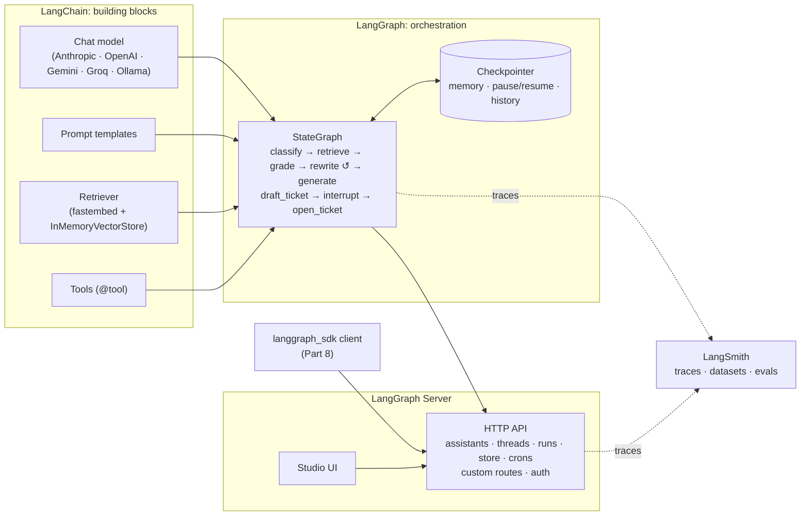
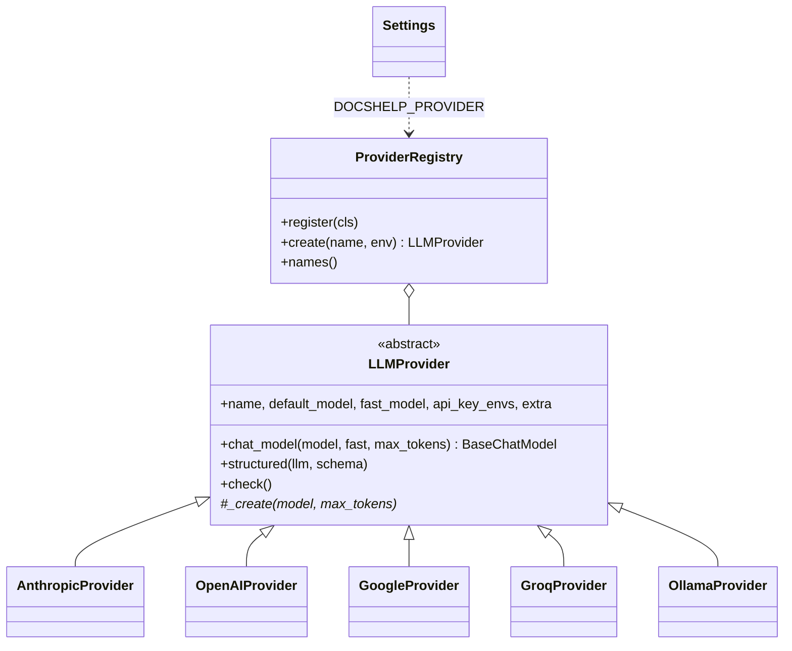

# DocsHelp: the LangChain ecosystem, one lesson at a time

[](https://github.com/RGB314/docshelp/actions/workflows/ci.yml)

A small but realistic app, a support assistant for the made-up product **Nimbus Notes**, that grows lesson by
lesson until it covers everything taught in the [LangChain Academy](https://academy.langchain.com/collections)
(LangChain, LangGraph, LangSmith, Deep Agents and deployment). Every concept is applied to this one app instead
of a different toy project per course, and everything runs at **zero cost**: local Ollama models by default,
free-tier cloud models optionally, and no paid LangSmith features required.

[CURRICULUM.md](CURRICULUM.md) maps every Academy lesson to the lesson here that teaches it, and ends each part
with self-check questions.

| Part | Theme | Run | Status |
|---|---|---|---|
| 1 | **LangChain essentials:** models and messages, prompts and LCEL, structured output, multimodal, RAG, tools and `create_agent`, streaming, short-term memory, dynamic prompts | `uv run poe lesson 1.1` … `1.10` | ✅ |
| 2 | **Production-ready agents:** MCP, runtime context and state, multi-agent, middleware, long conversations, human-in-the-loop, dynamic agents | `uv run poe lesson 2.1` … `2.9` | ✅ |
| 3 | **LangGraph core:** state, reducers, schemas, message management, persistence, streaming, interrupts, time travel, Studio | `uv run poe lesson 3.1` … `3.15` | ✅ |
| 4 | **LangGraph at scale + long-term memory:** parallelism, subgraphs, map-reduce, a research assistant, the Store, memory schemas | `uv run poe lesson 4.1` … `4.9` | ✅ |
| 5 | **LangSmith:** tracing, datasets, evaluators, experiments, pairwise, evals as tests, prompts, feedback, annotation | `uv run poe lesson 5.1` … `5.12` | ✅ |
| 6 | **Agent projects:** an ambient support-inbox agent (triage, Agent Inbox, learning memory, evals) and a deep-research agent (scoping, parallel researchers, MCP, reports) | `uv run poe lesson 6.1` … `6.9` | ✅ |
| 7 | **Deep Agents:** planning, filesystem backends, a shell and an interpreter, offloading, skills, `AGENTS.md` memory, subagent teams (sync, dynamic, async), agents from templates, dcode | `uv run poe lesson 7.1` … `7.16` | ✅ |
| 8 | **Deployment:** LangGraph Server, the SDK and `RemoteGraph`, threads and runs, double texting, assistants, custom routes, the server's Store, auth, Chat UI and your own UI, crons, Docker | `uv run poe server`, then `uv run poe lesson 8.1` … `8.13` | ✅ |
| 9 | **Production monitoring:** traffic and filters, cost, latency and errors, online evaluators and sentiment, automations and alerts, security, A/B tests, Insights and dashboards twins, and the Engine improvement loop | `uv run poe lesson 9.1` … `9.11`, `uv run poe dashboard` | ✅ |

## Contents

<!-- toc -->
- [How the pieces fit together](#how-the-pieces-fit-together)
- [Runs the same on Windows, macOS and Linux](#runs-the-same-on-windows-macos-and-linux)
- [Prerequisites](#prerequisites)
  - [Supported model providers](#supported-model-providers)
  - [1. Install uv](#1-install-uv-one-time-option-a-only)
  - [2. Set up your model provider](#2-set-up-your-model-provider)
  - [3. (Optional) Get a LangSmith API key](#3-optional-get-a-langsmith-api-key)
- [Setup](#setup)
  - [Option A: uv](#option-a-uv)
  - [Option B: Docker Compose](#option-b-docker-compose)
  - [Option C: Dev Container / GitHub Codespaces](#option-c-dev-container--github-codespaces)
  - [Configure `.env`](#configure-env-all-options)
- [Running the lessons](#running-the-lessons)
  - [Part 1: LangChain essentials](#part-1-langchain-essentials)
  - [Part 2: Production-ready agents](#part-2-production-ready-agents)
  - [Part 3: LangGraph core](#part-3-langgraph-core)
  - [Part 4: LangGraph at scale and long-term memory](#part-4-langgraph-at-scale-and-long-term-memory)
  - [Part 5: LangSmith observability and evaluation](#part-5-langsmith-observability-and-evaluation)
  - [Part 6: Agent projects (ambient inbox and deep research)](#part-6-agent-projects-ambient-inbox-and-deep-research)
  - [Part 7: Deep Agents](#part-7-deep-agents)
  - [Part 8: Deployment](#part-8-deployment)
  - [Part 9: Production monitoring and the improvement loop](#part-9-production-monitoring-and-the-improvement-loop)
- [Project layout](#project-layout)
- [Tests](#tests)
- [How the provider layer is designed](#how-the-provider-layer-is-designed)
- [Contributing](#contributing)
- [Notes and next steps](#notes-and-next-steps)
<!-- tocstop -->

## How the pieces fit together



In one sentence each:
- **LangChain** is the standard library: models, prompts, retrievers and tools behind common, swappable interfaces.
- **LangGraph** is the runtime for agents: you define the steps as a graph, and it handles state, persistence, loops and pausing for a human.
- **LangSmith** is observability and quality: see every step of every run, and measure whether a change made the app better or worse.
- **LangGraph Server / Studio** is deployment and debugging: turn a graph into a production-style API without writing web code, and inspect it visually.

## Runs the same on Windows, macOS and Linux

Pick whichever way of running suits you. All three give the same pinned Python 3.12 environment from `uv.lock`,
and use the same commands.

| Option | You install | Best for |
|---|---|---|
| **A. uv (recommended)** | [uv](https://docs.astral.sh/uv/) only. It fetches Python 3.12 itself. | Fastest; runs natively. Any OS, any shell. |
| **B. Docker Compose** | [Docker Desktop](https://www.docker.com/products/docker-desktop/) (or Docker Engine) | Zero local Python; the whole stack (app + LangGraph Server + optional Ollama) in containers |
| **C. Dev Container** | VS Code + Docker, or nothing at all with GitHub Codespaces | A ready-made editor environment, one click from GitHub |

Every command in this README is the same in **PowerShell, cmd, Git Bash, macOS and Linux**: `uv run poe <task>`,
powered by [poethepoet](https://poethepoet.natn.io/). The few steps that differ by shell are shown side by side.
Run `uv run poe` to list all tasks.

Under the hood:
- Paths use `pathlib`.
- Output is forced to UTF-8, so Windows pipes and Git Bash don't crash on ✓ or ⏸.
- `.gitattributes` keeps line endings as LF everywhere.
- Helper tasks are written in Python instead of shell scripts.

## Prerequisites

| What | Required? | Why |
|---|---|---|
| uv, **or** Docker | Yes | See the options above. uv installs Python 3.12 and all dependencies into `.venv`. |
| **One** model provider (see below) | Yes | Every lesson calls a chat model. The default, Ollama, is free and local; Groq and Gemini have free tiers. |
| LangSmith API key | Optional (free Developer account) | Tracing, datasets, experiments, prompts and feedback in the LangSmith UI. Without it, Part 5 runs everything locally. |
| Internet access | Yes | For downloads, plus a one-time ~70 MB embedding model. With Ollama, the lessons then run fully offline. |
| ~1.5 GB disk | Yes | Python, the virtual environment and the model cache (plus ~5 GB per model if you use Ollama). |

### Supported model providers

| `DOCSHELP_PROVIDER` | Cost | Default model / fast model | Vision model (lesson 1.4) | Key (env var) | Get it |
|---|---|---|---|---|---|
| `ollama` (default) | Free, local | `qwen3:8b` / `qwen3:4b` | `gemma3:4b` | none (`OLLAMA_BASE_URL` optional) | [Ollama](https://ollama.com/download) |
| `groq` | Free tier | `openai/gpt-oss-120b` / `openai/gpt-oss-20b` | `meta-llama/llama-4-scout-17b-16e-instruct` | `GROQ_API_KEY` | [GroqCloud](https://console.groq.com/keys) |
| `google` | Free tier | `gemini-3.8-flash` / `gemini-3.5-flash-lite` | default model | `GOOGLE_API_KEY` (or `GEMINI_API_KEY`) | [Google AI Studio](https://aistudio.google.com/apikey) |
| `anthropic` | Paid | `claude-sonnet-5` / `claude-haiku-4-5` | default model | `ANTHROPIC_API_KEY` | [Claude Console](https://console.anthropic.com/settings/keys) |
| `openai` | Paid | `gpt-5.4-mini` / `gpt-5-mini` | default model | `OPENAI_API_KEY` | [OpenAI Platform](https://platform.openai.com/api-keys) |

Override the models with `DOCSHELP_MODEL` / `DOCSHELP_FAST_MODEL` / `DOCSHELP_VISION_MODEL`. Model names change
often; check your provider's model list if a default is retired. The paid providers are optional and never
needed. Ollama runs everything for free on your machine. For the tool-heavy later parts (6–7), a free Groq or
Gemini key gives noticeably better results than a small local model. Free tiers have rate limits, and
the experiment lessons (5.6, 5.7) make about 50 calls, so they may run slowly on them.

### 1. Install uv (one time, Option A only)

Use the official standalone installer. It puts `uv` in a fixed folder (`~/.local/bin`; on Windows
`%USERPROFILE%\.local\bin`) and adds that folder to your PATH once. Updates replace the file in place, so you
never touch PATH again.

**Windows** (the same line works in PowerShell, cmd and Git Bash):
```powershell
powershell -ExecutionPolicy ByPass -c "irm https://astral.sh/uv/install.ps1 | iex"
```
**macOS / Linux:**
```bash
curl -LsSf https://astral.sh/uv/install.sh | sh
```
Open a **new** terminal (Git Bash picks up the Windows PATH change too), then check it with `uv --version`.
Later, update with `uv self update`.

> Don't install uv with `pip install --user uv`. That puts it in a Python-version-specific folder
> (e.g. `...\Python\Python314\Scripts`) that changes whenever you upgrade Python.

### 2. Set up your model provider

<details>
<summary><b>Anthropic</b> (paid)</summary>

1. Sign in or sign up at the [Claude Console](https://console.anthropic.com) (it may redirect to `platform.claude.com`).
2. Add credits under **Settings → Billing**. API usage is prepaid and separate from any Claude.ai subscription.
   A few dollars is plenty for this demo.
3. **Settings → API Keys → Create Key**, and copy it immediately (it starts with `sk-ant-` and is shown once).
</details>

<details>
<summary><b>OpenAI</b> (paid)</summary>

Sign in at <https://platform.openai.com>, add credits under **Settings → Billing**, then create a key at
**API keys → Create new secret key**.
</details>

<details>
<summary><b>Google Gemini</b> (free tier)</summary>

Sign in to [Google AI Studio](https://aistudio.google.com/apikey) with a Google account and click **Create API key**.
No payment details are needed for the free tier.
</details>

<details>
<summary><b>Groq</b> (free tier)</summary>

Sign up at <https://console.groq.com>, then **API Keys → Create API Key**. No payment details are needed for the free tier.
</details>

<details>
<summary><b>Ollama</b> (free, runs on your machine, no key)</summary>

1. Install Ollama from <https://ollama.com/download> and make sure it's running.
2. Download the models: `ollama pull qwen3:8b` and `ollama pull qwen3:4b` (8 GB+ of free RAM recommended;
   a GPU helps a lot). On a smaller machine, use `qwen3:4b` for both via `DOCSHELP_MODEL`.
3. For the image lesson (1.4) only: `ollama pull gemma3:4b`.

With Docker (Option B) you can skip installing Ollama: `docker compose --profile ollama up -d ollama`, then
`docker compose exec ollama ollama pull qwen3:8b` (repeat the pull for `qwen3:4b`). The models are kept in a Docker volume.
</details>

### 3. (Optional) Get a LangSmith API key

Sign up at <https://smith.langchain.com> (the free tier is enough), then go to **Settings → API Keys → Create API Key**.

## Setup

### Option A: uv

```bash
uv sync --extra ollama       # use your provider: anthropic | openai | google | groq | ollama
uv run poe setup             # creates .env from .env.example, then checks your provider setup
```

Each provider's LangChain integration is an optional extra, so you install only what you use.
`uv sync --all-extras` installs all five. Plain `uv sync` removes extras, so always repeat
the `--extra` flag when you re-sync. `uv run` leaves them alone.

### Option B: Docker Compose

```bash
docker compose build                        # image with all five provider integrations + the embedding model
docker compose run --rm app poe init-env    # or copy .env.example to .env yourself
docker compose run --rm app poe doctor
```

Inside containers the commands are the same as Option A, just prefixed with `docker compose run --rm app`
instead of `uv run`. Compose passes the values in your `.env` to the containers at run time. Put your keys
there: variables set in your host shell are *not* passed into containers. The `.env` file itself is **never**
copied into the image (see `.dockerignore`).

### Option C: Dev Container / GitHub Codespaces

Open the repo in VS Code and choose **Reopen in Container**, or on GitHub click **Code → Codespaces → Create**.
The container installs uv and all extras, creates `.env`, and forwards port 2024. Then use the Option A commands
in its terminal.

### Configure `.env` (all options)

Edit `.env`:
- `DOCSHELP_PROVIDER`: your provider (e.g. `ollama`).
- The API key for that provider only. The other key lines can stay empty.
- `LANGSMITH_API_KEY` is **optional but recommended**. With it and `LANGSMITH_TRACING=true`, every lesson is
  traced automatically with no code changes.

**Keeping keys out of git:** settings are read only from environment variables. `.env` is just a
convenient way to set them locally, and it's git-ignored, so only `.env.example` (with empty values) is committed.
You can skip `.env` entirely and set real environment variables instead:

| PowerShell | Git Bash / macOS / Linux |
|---|---|
| `$env:DOCSHELP_PROVIDER = "groq"` | `export DOCSHELP_PROVIDER=groq` |
| `$env:GROQ_API_KEY = "gsk_..."` | `export GROQ_API_KEY=gsk_...` |

Real environment variables take priority over `.env`. Run `uv run poe doctor` at any time to see which providers
are ready. If a key is missing, the lessons exit with a message saying which variable to set and where to get it.

Embeddings run locally on your CPU (`BAAI/bge-small-en-v1.5` via fastembed). The first run downloads about 70 MB into `.cache/`.

## Running the lessons

| Task | Option A (uv, any shell) | Option B (Docker, any shell) |
|---|---|---|
| List the lessons | `uv run poe lessons` | `docker compose run --rm app poe lessons` |
| Run a lesson | `uv run poe lesson 1.6` | `docker compose run --rm app poe lesson 1.6` |
| Evals against your model (lesson 5.9) | `uv run poe evals` | `docker compose run --rm app poe evals` |
| LangGraph Server (Part 8) | `uv run poe server` | `docker compose up -d server` |
| The server with auth (lesson 8.10) | `uv run poe server-auth` | `docker compose up -d server-auth` |
| Tests | `uv run poe test` | `docker compose run --rm app poe test` |
| Provider check | `uv run poe doctor` | `docker compose run --rm app poe doctor` |
| Monitoring dashboard (Part 9) | `uv run poe dashboard` | `docker compose run --rm app poe dashboard` |

Lessons live in `lessons/p<part>_<topic>/<NN>_<topic>.py`. Each one opens with a docstring naming the Academy
lessons it covers and the concepts it teaches. Each has a `run()` the tests drive with a scripted model and a
`main()` that wires in your real model. Extra arguments go to the lesson: `uv run poe lesson 1.10 --chat`.

### Part 1: LangChain essentials

| Lesson | What you see | Look for |
|---|---|---|
| 1.1 Models and messages | `invoke`, message types, token usage, `batch()`, swapping to the fast model | the model only "remembers" because the history is resent |
| 1.2 Prompts and LCEL | templates, few-shot examples, `MessagesPlaceholder`, `prompt \| llm \| parser`, `RunnableParallel` | the exact message list the model receives |
| 1.3 Structured output | a support email turned into a validated `Triage` object, then a whole inbox in one `batch()` | provider-neutral `structured_llm()` |
| 1.4 Multimodal | a generated error screenshot sent as an image block to a vision model | the model reads the error code from the image |
| 1.5 RAG | load → split → embed (local) → retrieve → answer with citations | "get my money back" finds *Refunds* with no shared keywords |
| 1.6 Tools and agents | `@tool` schemas, a tool call by hand, then `create_agent` doing the loop | the agent calls docs search *and* the pricing tool |
| 1.7 Streaming | tokens from the model; `updates`, `messages` and `custom` streams from the agent | "Searching docs…" progress sent from inside a tool |
| 1.8 Short-term memory | a checkpointer with one thread per conversation | a second thread knows nothing |
| 1.9 Dynamic prompt | runtime `context` (the customer's plan) rewrites the system prompt per call | Free vs Enterprise answers to the same question |
| 1.10 Capstone | the support agent (`src/docshelp/agents.py`): tools + memory + plan-aware prompt + `SupportAnswer` | `sources` and `needs_ticket` as data; `--chat` to talk to it |

### Part 2: Production-ready agents

| Lesson | What you see | Look for |
|---|---|---|
| 2.1 MCP | a local MCP server (`src/docshelp/mcp_server.py`) started over stdio; its tools, resource and prompt | MCP tools used by the agent exactly like local ones |
| 2.2 Context and state | `ToolRuntime` reading the caller's account from context; a tool saving the device to custom state with `Command` | `my_account` has no arguments, so the model can't pick an account |
| 2.3 Multi-agent | a supervisor delegating to docs, billing and MCP-backed status specialists (`src/docshelp/team.py`) | the supervisor only sees questions and answers, never the specialists' tool calls |
| 2.4 Middleware | all six hooks logged by `AuditLog` (`src/docshelp/middleware.py`); a guard that ends the run early | the password message never reaches the model; the log in `data/audit.jsonl` |
| 2.5 Prebuilt middleware | tool retry, tool and model call limits, model retry and fallback | a flaky tool recovers; a missing model falls back to a working one |
| 2.6 Long conversations | `SummarizationMiddleware`, trimming with `RemoveMessage`, `ContextEditingMiddleware` | the message count dropping after the summary |
| 2.7 Human in the loop | `HumanInTheLoopMiddleware` on `open_ticket`: approve, edit, reject (`--review` to decide yourself) | the edited priority is what's saved to `data/tickets.jsonl` |
| 2.8 Dynamic agents | model chosen by difficulty, tools chosen by plan | Free customers are never offered `open_ticket` |
| 2.9 Capstone | the email assistant (`src/docshelp/email_assistant.py`): verify sender → account tools unlock → research → approved reply | the reply in `data/outbox.jsonl` only after approval; `--review` to edit it |

### Part 3: LangGraph core

| Lesson | What you see | Look for |
|---|---|---|
| 3.1 State, nodes, edges | a clean → tag → reply pipeline as a `StateGraph`; each node's partial update | the model only ever sees the cleaned text (email masked) |
| 3.2 Conditional edges and `Command` | an LLM router built twice: `add_conditional_edges`, then `Command(goto=...)` | both versions route the same messages to the same teams |
| 3.3 ReAct agent by hand | `assistant` + `ToolNode` + `tools_condition` + a loop (`src/docshelp/react.py`), with memory | the graph `create_agent` builds for you |
| 3.4 Studio | the graphs in `langgraph.json`, then `uv run poe server` to open LangGraph Studio | chat, step through nodes, edit state and fork in the UI |
| 3.5 State schemas | TypedDict, dataclass and Pydantic state | Pydantic rejects bad *input*, but never checks node output |
| 3.6 Reducers | two parallel taggers: `InvalidUpdateError`, then a custom reducer; `add_messages` replace and remove | messages replaced and removed by `id` |
| 3.7 Multiple schemas | `input_schema` / `output_schema` and private state between nodes | the caller gets only `answer` and `sources` |
| 3.8 Trim and filter | filter in the call, delete with `RemoveMessage`, trim by tokens | which strategy really shrinks the saved state |
| 3.9 Summarizing chatbot | a `summary` key, a conditional summarize step (`src/docshelp/chatbot.py`) | the summary moving into the system prompt |
| 3.10 External memory | `SqliteSaver`: session 2 continues session 1's thread from `data/checkpoints.sqlite` | the messages and checkpoints loaded from disk |
| 3.11 Streaming | `values` + `updates` together, `messages` filtered by node, `astream_events` | tokens from the `assistant` node only |
| 3.12 Breakpoints and editing state | `interrupt_before=["tools"]`, `update_state` to fix tool args, `as_node="tools"` to answer for a tool | the edited call (15 members) is the one that runs |
| 3.13 Dynamic interrupts | `interrupt()` in a node: ask again for an invalid account id, manager approval over $100 (`--interactive`) | the refund pausing only when needed |
| 3.14 Time travel | `get_state_history`, replay from a past step, fork with a changed question | the original branch left untouched |
| 3.15 Capstone | the support graph (`src/docshelp/graph.py`): route → retrieve → grade → rewrite ↺ → answer, or ticket → approval (`--review`) | the `RetryPolicy`, the rewrite loop and the pause; `graph.mmd` diagram |

### Part 4: LangGraph at scale and long-term memory

| Lesson | What you see | Look for |
|---|---|---|
| 4.1 Parallelization | docs, changelog and status page searched at once, then one answer | step 1 runs three nodes; `answer` waits for the longer docs branch |
| 4.2 Subgraphs | a ticket review made of two subgraphs (failure analysis, FAQ ideas) run in parallel | events streamed from *inside* each subgraph; private keys never reach the parent |
| 4.3 Map-reduce | one `Send` per retrieved document takes notes, then one answer from the notes | as many parallel calls as documents |
| 4.4 Research assistant | an editor approves reader perspectives, interviews run in parallel, then an article is written (`src/docshelp/research.py`) | the feedback loop; `--interactive` to be the editor |
| 4.5 Store | a fact sheet written to the Store and recalled in a *new* thread; a `create_agent` tool writing to it | thread 2 knows the OS without seeing thread 1 |
| 4.6 Semantic memory search | past tickets embedded locally and searched by meaning, with filters | the closest past issues for a new complaint |
| 4.7 Memory profile | a `CustomerProfile` extracted, then *patched* with trustcall | switching to macOS keeps every other field |
| 4.8 Memory collection | `PastIssue` items: one updated to solved, one inserted | `issue-1` updated in place, `issue-2` added |
| 4.9 Capstone | a support agent that decides what to remember (`src/docshelp/memory.py`) | a brand-new thread already knows the customer's problem |

### Part 5: LangSmith observability and evaluation

Every lesson runs **without a LangSmith account**: the same `langsmith` SDK builds traces locally (saved to
`data/traces.jsonl`) and runs evaluations with `upload_results=False`. Add `LANGSMITH_TRACING=true` and a free
`LANGSMITH_API_KEY` to `.env` to see the same traces, datasets, experiments, prompts and feedback in the
LangSmith UI.

| Lesson | What you see | Look for |
|---|---|---|
| 5.1 Tracing basics | one agent request as a tree of runs, with latency and tokens (`src/docshelp/observability.py`) | where the time and tokens went |
| 5.2 Run types and `@traceable` | a hand-written RAG pipeline traced as retriever → prompt → llm → parser | the email masked in the recorded inputs |
| 5.3 Threads and analysis | two conversations grouped by `thread_id`; the slowest model calls | per-thread turns, tokens and latency |
| 5.4 Datasets | `data/eval_dataset.json` as examples with splits and a version; synthetic variations | "base" vs "edge" splits |
| 5.5 Evaluators | code checks, an LLM judge (`openevals`), trajectory checks (`agentevals`) | a right answer reached the wrong way still fails |
| 5.6 Experiments | the RAG chain vs the support graph over the dataset, compared (replaces stage 4) | the questions where they disagree |
| 5.7 Pairwise | a judge picks the better of two answers, with the order swapped | position bias handled |
| 5.8 Summary evaluators | ticket triage scored with precision, recall and F1 | one score for the whole experiment |
| 5.9 Evals as tests | `evals/` run with pytest and LangSmith's pytest plugin (`uv run poe evals`) | failing evals as test failures |
| 5.10 Prompt engineering | prompt versions in a hub (`src/docshelp/prompts.py`), evaluated, then promoted by tag | `docshelp-rag:prod` moving to the better version |
| 5.11 User feedback | 👍/👎 attached to the exact run that was rated (`--rate` to rate yourself) | feedback joined to traces |
| 5.12 Annotation queues | uncited answers queued for review; corrections become dataset examples (`--review`) | the loop from mistake to test case |

### Part 6: Agent projects (ambient inbox and deep research)

| Lesson | What you see | Look for |
|---|---|---|
| 6.1 Ambient inbox agent | the 8 emails in `data/inbox/` triaged and answered on their own (`src/docshelp/ambient.py`) | newsletters and auto-replies never reach the response agent |
| 6.2 Ambient evaluations | triage accuracy on every email; tool calls and per-email success criteria on the replies | where the agent errs, not just how often |
| 6.3 Human in the loop | Agent Inbox requests: accept / edit / respond / ignore (`--interactive` to decide) | a rejected draft is never sent; the edited ticket priority is |
| 6.4 Memory | triage and reply preferences learned from the lead's edits and ignores | the learned sign-off appears in later replies |
| 6.5 Research scoping | a clarifying question, then a research brief | the run *ends* with the question; the answer continues the thread |
| 6.6 Research agent | search, `think`, search again, then compressed and cited findings (`--web` adds web search) | the reflections between searches |
| 6.7 Research agent with MCP | the same agent reading `data/docs/` through an MCP server (`src/docshelp/docs_mcp_server.py`) | only the tools changed |
| 6.8 Research supervisor | parallel researchers delegated with `ConductResearch`, within limits | one turn starts several researchers at once |
| 6.9 Capstone | request → scoping → parallel research → report in `data/reports/`, graded by an LLM judge | a cited report and its quality score |

### Part 7: Deep Agents

| Lesson | What you see | Look for |
|---|---|---|
| 7.1 Running a deep agent | `create_deep_agent` plans with `write_todos`, uses tools, and writes a triage note to its virtual filesystem | the plan and the file in the final state |
| 7.2 Models and the system prompt | a subagent on the fast model, and the full assembled system prompt | your prompt first, then what the harness adds |
| 7.3 Tools and MCP | DocsHelp tools and MCP status tools side by side, with runtime context | the customer's region decides which status is checked |
| 7.4 Threads and HITL | two threads with their own files; publishing under `/published/` waits for approval | drafts are free, publishing needs a person |
| 7.5 Filesystem backends | one tree from four backends: docs on disk (read-only), Store, reports on disk, state | where each file really lands; the denied edit |
| 7.6 Sandbox and local shell | the agent writes and runs a Python script in a temp dir; an allowlist rejects other commands | the safety checklist in the docstring |
| 7.7 Interpreter | one `eval` of JavaScript calls `list_tickets` and returns only the counts (`langchain-quickjs`) | the raw tickets never reach the model |
| 7.8 Summarization and offload | a large log offloaded to a file and grepped; old turns summarized and saved to `/conversation_history/` | the model's context shrinks; the thread keeps everything |
| 7.9 Skills | `skills/refund-policy` and `skills/log-analysis`, listed in the prompt and read on demand | only names and descriptions are always in context |
| 7.10 Memory | the agent edits `/memories/AGENTS.md` once; a new thread follows the new rule | memory shared across threads through the Store |
| 7.11 Subagent team | a ticket analyst (structured output), a docs researcher, and the 3.3 ReAct agent as a compiled subagent | each subagent sees only its task |
| 7.12 Dynamic subagents | code in the interpreter triages every open ticket with parallel subagents | typed results filtered in code |
| 7.13 Async subagents | background research on a local stand-in server, or on `uv run poe server` with `--url` | the main agent answers while the task runs |
| 7.14 Capstone | the Support Ops analyst: plan, delegate, use a skill, write `data/reports/windows-sync.md` after approval, learn a rule | every Part 7 feature in one agent |
| 7.15 Agents from templates | `agents/*.md` templates (a Fleet twin) become a refund desk and an inbox watcher | one builder, many agents; MDA's layout explained |
| 7.16 dcode project config | `.deepagents/` (memory, skill, subagent, `.mcp.json`) loaded with the SDK | the folder dcode reads is plain deep-agent config |

### Part 8: Deployment

Part 8's lessons are clients of a running server. Start it in one terminal, then run the lessons in another:

```bash
uv run poe server            # terminal 1: API on :2024 (lesson 8.10 uses `uv run poe server-auth`, on :2025)
uv run poe lesson 8.1        # terminal 2
```
With Docker, run `docker compose up -d server server-auth`, then `docker compose run --rm app poe lesson 8.1`.
Studio is at <https://smith.langchain.com/studio/?baseUrl=http://127.0.0.1:2024>, and a small chat page at
<http://127.0.0.1:2024/ui>.

| Lesson | What you see | Look for |
|---|---|---|
| 8.1 Deployment concepts | `langgraph.json` explained, the live server's info, one assistant per graph, a graph's drawing and context schema | what the server adds to a graph |
| 8.2 SDK and `RemoteGraph` | stateless runs with the sync and async clients; a deployed graph used like a local one, and as a node in a local graph | small talk never leaves the local graph |
| 8.3 Threads, runs and streaming | node updates, tokens, a background run, the ticket approval resumed over the API, history, search and forks | the run pauses; a `command` resumes it |
| 8.4 Double texting | a second message while the first run works, under reject, enqueue, interrupt and rollback | what the thread holds afterwards |
| 8.5 Assistants | a concise chat assistant and a detailed email assistant from one graph; versions and rollback | settings without code or redeploys |
| 8.6 Custom routes | `/health`, `/tickets` and `/ui` from `src/docshelp/webapp.py`, served next to the API | your routes in the same OpenAPI document |
| 8.7 The server's Store | a CRM job writes a memory; the memory agent remembers Ada across threads; semantic search with local embeddings | the same memories from the agent and the SDK |
| 8.8 A deep agent on the server | the Ops analyst's report approved over the API; its `AGENTS.md` read back from the server's Store | the memory changes, and a new thread follows it |
| 8.9 Deploying without code | Markdown templates from `agents/` become assistants of one graph factory | a new agent is a file plus an API call |
| 8.10 Auth | tokens from a local stand-in provider; owners only, staff roles, the run's account taken from the token | 401, 403 and 404, each for a reason |
| 8.11 Chat UI and your own UI | one chat turn over plain HTTP and server-sent events; Agent Chat UI, Studio and Agent Inbox | every UI uses the same API |
| 8.12 Ambient agent deployment | an ingest graph starts one run per email, a cron schedules it, drafts wait in an inbox | ingesting twice answers nothing twice |
| 8.13 Shipping to production | the generated production Dockerfile, this repo's compose services, the checklist | the same client code, a different URL |

### Part 9: Production monitoring and the improvement loop

Lesson 9.1 plays the conversations in `data/traffic.json` (angry customers, injections, pasted card numbers)
through the support agent and logs every turn to `data/monitoring/traces.jsonl`. The other lessons analyse that
log, generating it first if it's empty, so each also runs on its own. With a LangSmith key the traces also go
to your project, and each lesson names the LangSmith feature it mirrors.

| Lesson | What you see | Look for |
|---|---|---|
| 9.1 Production traffic and filters | traffic traced with thread, plan and variant metadata; LangSmith's filter language run locally | `and(eq(metadata_key, "plan"), eq(metadata_value, "team"))` |
| 9.2 Cost tracking | tokens and cost per turn and per plan, input vs output, what the traffic would cost on hosted tiers | every tool round re-sends the conversation |
| 9.3 Latency and errors | p50/p95/p99, time per model and tool run, an injected provider outage grouped by error type | the tail, not the mean |
| 9.4 Online evaluators | sentiment and helpfulness judges plus a code check, with filters and sampling, writing feedback | the unhappy customers, found automatically |
| 9.5 Automations and alerts | rules that queue errors for review, collect uncited answers into a dataset and notify security; windowed alerts | what fires, and why |
| 9.6 Security monitoring | PII redacted before the model sees it, injections refused and tagged, the trace anonymizer | proof the card number never reached the model |
| 9.7 A/B testing | two prompt versions, customers split by a stable hash, compared on live scores with a significance test | "not significant yet" |
| 9.8 Insights | every conversation summarised, then grouped into categories with counts (LangSmith Insights twin) | where to fix first |
| 9.9 Dashboards | one static HTML page: tiles, latency histogram, by plan and variant, scores, slowest traces, alerts | `data/reports/dashboard.html` |
| 9.10 Engine: find and fix | failures from the online scores, then an LLM's diagnosis and a new prompt saved as "candidate" | production is untouched |
| 9.11 Engine: test, ship, monitor | old vs candidate on failures plus regressions, a pairwise judge, ship only if better, then before/after | the whole lifecycle in one loop |

## Project layout

```
data/docs/              8 short Markdown pages documenting the made-up product
data/eval_dataset.json  9 question / reference-answer / expected-source examples
data/changelog.md       release notes; data/sample_tickets.jsonl: past tickets (Part 4)
data/triage_dataset.json  support emails labelled needs_ticket (lesson 5.8)
data/inbox/             the support inbox for the ambient agent, with evaluation labels (Part 6)
data/logs/              a customer's sync client log (Part 7)
data/traffic.json       simulated production conversations; data/pricing.json: token prices (Part 9)
skills/                 deep-agent skills: refund-policy, log-analysis (Part 7)
agents/                 agent templates, the Fleet twin (lesson 7.15)
.deepagents/            Deep Agents Code (dcode) project config: memory, skill, subagent, MCP (lesson 7.16)
src/docshelp/
  config.py             Settings (from env vars), get_llm / structured_llm facades, local fastembed embeddings
  providers/
    base.py             LLMProvider (abstract base) + ProviderRegistry (factory)
    vendors.py          Anthropic, OpenAI, Google Gemini, Groq and Ollama providers
  ingest.py             load → split → embed → InMemoryVectorStore → retriever
  tools.py              search_docs, quote_price, my_account, open_ticket, send_reply (data/*.jsonl)
  customers.py          Customer runtime context + a stand-in accounts database
  agents.py             the create_agent support agent (Part 1 capstone)
  mcp_server.py         the Nimbus Ops MCP server (status tools, resource, prompt)
  team.py               supervisor + specialist agents (Part 2.3)
  middleware.py         AuditLog: custom middleware using every hook
  email_assistant.py    the support email assistant (Part 2 capstone)
  react.py              a ReAct agent built by hand in LangGraph (Part 3.3)
  chatbot.py            a self-summarizing chatbot graph (Parts 3.9-3.10)
  sources.py            changelog, status page and sample tickets as extra sources (Part 4)
  research.py           the research assistant graph (Part 4.4)
  memory.py             long-term memory: schemas, trustcall updates, the memory agent (Part 4)
  observability.py      tracing (LangSmith or local), trace log, feedback (Part 5)
  evals.py              datasets, targets, evaluators, experiments, pairwise judge (Part 5)
  prompts.py            versioned prompts: LangSmith Prompt Hub or a local twin (Part 5)
  ambient.py            the ambient support-inbox agent, Agent Inbox protocol, learned preferences (Part 6)
  deep_research.py      scoping, researcher, supervisor and the full deep-research system (Part 6)
  docs_mcp_server.py    an MCP server exposing data/docs/ as files (lesson 6.7)
  deep.py               Deep Agents: tools, backends, subagent team, local agent server, the Ops analyst (Part 7)
  agent_templates.py    agents from Markdown templates and dcode project folders (lessons 7.15-7.16)
  monitoring.py         traffic, trace summaries, filter language, cost, online evaluators, rules, alerts, A/B (Part 9)
  guardrails.py         PII middleware, trace anonymizer and the prompt-injection guard (lesson 9.6)
  insights.py, dashboard.py, engine.py   Insights, Dashboards and Engine twins (lessons 9.8-9.11)
  graph.py              the LangGraph support graph, Part 3 capstone (dependencies injectable)
  server.py             graphs served by LangGraph Server / Studio (Part 8)
  deployment.py         the served support agent, the inbox ingest graph, store embeddings, client helpers (Part 8)
  auth.py               the server's authentication and authorization, and a local token issuer (lesson 8.10)
  webapp.py, chat.html  custom routes (/health, /tickets) and a chat page at /ui (lessons 8.6, 8.11)
  console.py            UTF-8 terminal output on every OS
  tasks.py              init-env, doctor and the lesson runner behind `poe`
lessons/                the curriculum: p1_langchain/, p2_production_agents/, ... (see CURRICULUM.md)
evals/                  evals as pytest tests (lesson 5.9; `uv run poe evals`), not part of `poe test`
tests/                  offline tests: scripted fake LLM + fake embeddings, no keys needed
langgraph.json          LangGraph Server / Studio config; langgraph.auth.json adds auth (lesson 8.10)
pyproject.toml          dependencies, provider extras, and the `poe` task definitions
Dockerfile              container image (uv + locked deps + pre-downloaded embedding model)
compose.yaml            app, server, server-auth and optional ollama services
.devcontainer/          VS Code Dev Container / GitHub Codespaces config
.gitattributes          LF line endings on every OS
```

## Tests

```bash
uv sync --all-extras    # once, so the provider tests can build each vendor's model class
uv run poe test         # unit + integration, ~2 min
uv run poe e2e          # end-to-end, ~10 min
```
Both suites run offline with no API keys.

**End-to-end tests** (`tests/e2e/`):
- Every lesson runs as a real process with no keys and must exit with clear setup instructions (no tracebacks).
- Two real LangGraph Servers serve the repo's `langgraph.json` and `langgraph.auth.json` with a rule-based fake model
  (`tests/e2e/fake_server/`), and every Part 8 lesson runs against them.
- With `DOCSHELP_E2E_MODEL` set and Ollama running, every lesson also runs against a real local model (Part 8's
  against the real servers), still
  with no keys:
  ```bash
  ollama pull qwen2.5:0.5b
  # PowerShell: $env:DOCSHELP_E2E_MODEL = "qwen2.5:0.5b"; uv run poe e2e
  DOCSHELP_E2E_MODEL=qwen2.5:0.5b uv run poe e2e
  ```

**CI** (`.github/workflows/ci.yml`) runs both suites natively on Ubuntu, Windows and macOS. A `docker-e2e` job
builds the image and runs the suites in the container, including the real-model lessons against the compose
`ollama` service, then runs lessons 8.3 and 8.10 against the compose `server` and `server-auth` services.

The unit tests cover:
- **every lesson:** its `run()` driven by `FakeChatModel` (a scripted `BaseChatModel` that streams and calls tools),
  checking what the model was sent and what came back
- **the curriculum:** every lesson listed in `CURRICULUM.md`, every reference real, no "planned" rows left in a
  shipped part
- **the graph:** every path (happy path, rewrite-and-retry loop, multi-turn memory, ticket approve/reject through
  `interrupt()` + `Command(resume=...)`)
- **providers:** key lookup from env, missing-key and missing-package errors, model/fast-model/max-token handling,
  structured-output strategy, registry behaviour
- **settings:** parsing and validation of every `DOCSHELP_*` variable
- **repo hygiene:** no machine-specific paths, `.env` git-ignored, `.env.example` documents every provider with empty
  values, every provider has a pyproject extra, and no lesson hard-codes a vendor or model
- **portability:**
  - UTF-8 output on non-UTF-8 streams, and the `poe` tasks and helpers
  - Dockerfile uses the lockfile and matching Python version; `.dockerignore` keeps secrets out
  - compose services and networking; Dev Container config; LF line endings

## How the provider layer is designed



- **Strategy:** each provider knows how to build its vendor's chat model and which structured-output method
  suits it (Groq uses tool calling; the others use native JSON schema). App code calls `get_llm()` /
  `structured_llm()` and never names a vendor.
- **Template Method:** `LLMProvider.chat_model()` always runs *check setup → pick model → build*. Subclasses
  implement only `_create()`.
- **Registry + Factory:** `@registry.register` adds a provider; `registry.create(name)` builds it.
- **Dependency injection:** providers and `Settings.from_env()` take the environment mapping to read, so tests pass
  fake environments and real keys only ever come from env vars.

**Adding a provider** (e.g. Mistral) touches no existing code:
1. Add an extra in `pyproject.toml`: `mistral = ["langchain-mistralai"]`.
2. Add a class in `providers/vendors.py`:
   ```python
   @registry.register
   class MistralProvider(LLMProvider):
       name = display_name = extra = "mistral"
       module = "langchain_mistralai"
       api_key_envs = ("MISTRAL_API_KEY",)
       default_model, fast_model = "mistral-medium-latest", "mistral-small-latest"
       signup_url = "https://console.mistral.ai/api-keys"

       def _create(self, model, max_tokens, **kwargs):
           from langchain_mistralai import ChatMistralAI
           return ChatMistralAI(model=model, api_key=self.api_key(), max_tokens=max_tokens, **kwargs)
   ```
3. Add `MISTRAL_API_KEY=` to `.env.example`. The hygiene tests will remind you if you forget.

## Contributing

`main` is protected: changes go in through pull requests, and CI must pass on all four checks (three operating
systems plus Docker). See [AGENTS.md](AGENTS.md) for the project rules. It's written for AI coding agents, but
it's just as useful for humans. `CLAUDE.md` points Claude Code at it.

## Notes and next steps

- Embeddings always run locally with fastembed, whichever chat provider you choose, so RAG works the same
  (and costs nothing) everywhere.
- `InMemorySaver` / `InMemoryVectorStore` keep the demo dependency-free. For production, swap in
  `langgraph-checkpoint-postgres` and a persistent vector store; the rest of the code doesn't change.
- All nine parts are built. [ROADMAP.md](ROADMAP.md) records how each was built and what to watch when the libraries
  change; [CURRICULUM.md](CURRICULUM.md) maps every Academy lesson and ends each part with self-check questions.
